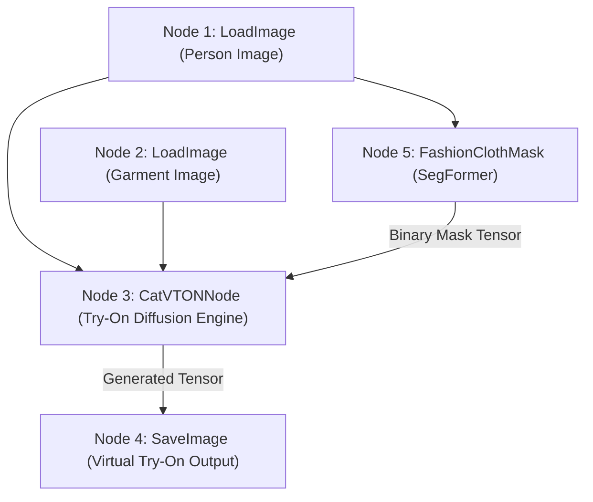

# ComfyUI Engine & Workflow Validation Report

**Subsystem**: ComfyUI Virtual Try-On Graph  
**Server URL**: `http://127.0.0.1:8188`  
**Blueprint File**: `workflow_api.json`  
**Validation Date**: October 2026  
**Status**: **PASS**

---

## 1. Graph Architecture & Node Pipeline

The automated ComfyUI workflow executes as an acyclic execution graph without user interface intervention:

### Node Specifications

1. **Node 1 (`LoadImage`)**:
   - Class: `LoadImage`
   - Inputs: `{"image": "person_1.jpg"}`
   - Outputs: Image tensor `[1, H, W, 3]`.

2. **Node 2 (`LoadImage`)**:
   - Class: `LoadImage`
   - Inputs: `{"image": "garment_1.jpg"}`
   - Outputs: Garment image tensor `[1, H_g, W_g, 3]`.

3. **Node 5 (`FashionClothMask`)**:
   - Class: `FashionClothMask` (Custom SegFormer-b3 node)
   - Inputs: Image from Node 1, plus category boolean toggles:
     - `upper_body_cloth`: `true` / `false`
     - `lower_body_cloth`: `true` / `false`
     - `dresses_cloth`: `true` / `false`
     - `shoes`, `bags`, `hats`, `scarf`
   - Outputs: Single-channel mask tensor `[1, H, W]`.

4. **Node 3 (`CatVTONNode`)**:
   - Class: `CatVTONNode`
   - Inputs:
     - `image`: Node 1
     - `garment`: Node 2
     - `mask`: Node 5
     - `steps`: 15 to 25
     - `cfg`: 2.5
     - `seed`: Random / fixed
     - `sampler`: `euler`
     - `scheduler`: `normal`
     - `checkpoint`: `mix-48k-1024`
   - Outputs: Inpainted RGB image tensor `[1, H, W, 3]`.

5. **Node 4 (`SaveImage`)**:
   - Class: `SaveImage`
   - Inputs: Node 3 image output, `filename_prefix: "ComfyUI"`.
   - Output: PNG file stored in `~/ComfyUI/output/`.

---

## 2. API Communication & Polling Mechanism

The backend communicates with ComfyUI asynchronously through standard HTTP endpoints:
- `POST /prompt`: Dispatches graph with updated input filenames and runtime flags. Returns `{ "prompt_id": "<uuid>" }`.
- `GET /history/{prompt_id}`: Polls execution state. Fast failure detection is implemented for `status.status_str == "error"`.
- `GET /view?filename=...&subfolder=...&type=output`: Fetches raw generated image bytes.

---

## 3. ComfyUI Server Management

- **Startup Script**: `/home/lenovo/ComfyUI/start_comfyui.sh`
- **Command Line**: `python3 main.py --listen 127.0.0.1 --port 8188`
- **Log Location**: `/home/lenovo/ComfyUI/comfyui.log`
- **Dependencies Resolved**: `comfy-aimdo==0.6.0` installed in Python 3.14 virtual environment.

