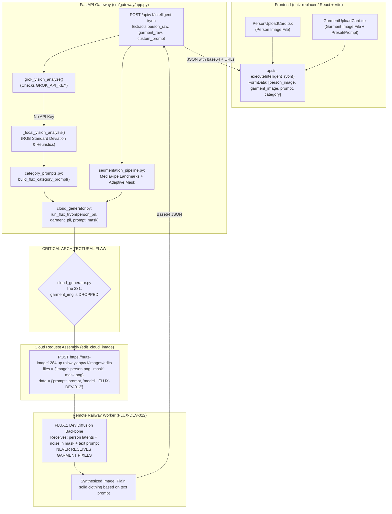

# NUTZ REPLACER: FLUX DIRECT VS INTEGRATED WORKFLOW AUDIT
**Document ID:** AUDIT-FLUX-INT-2026-11-16  
**Status:** COMPLETE (STRICT AUDIT-ONLY PHASE)  
**Target Repository:** `/home/lenovo/try_on`  
**Classification:** Technical Architecture & Root Cause Investigation Report  

---

## 1. EXECUTIVE SUMMARY

This technical audit investigates a critical discrepancy observed in the **Nutz Replacer** virtual try-on system:

> **Problem Statement:** Direct usage of the FLUX model produces superior garment pattern preservation and faithful clothing reproduction. However, when executed through the integrated Nutz Replacer frontend and backend, the generated images frequently simplify, distort, recolor, or completely erase original garment patterns (e.g., generating a solid emerald green shirt when the input was a pale mint green shirt featuring repeating micro character motifs). Furthermore, users experience prolonged processing latency.

### The Fundamental Root Cause
Through static code analysis and request tracing across the full stack, the primary technical failure was identified:

**The garment reference image (`garment_img`) is NEVER transmitted to the FLUX diffusion model.**

1. In `src/inference/cloud_generator.py` (lines 209–245), the try-on function `run_flux_tryon(person_img, garment_img=..., ...)` accepts `garment_img` as a parameter. However, inside the function body, it calls `edit_cloud_image()` with only `image=person_img` and `mask=mask_img`. **`garment_img` is completely discarded.**
2. In `edit_cloud_image()` (lines 154–165), the multipart payload sent to `https://nutz-image1284.up.railway.app/v1/images/edits` contains only:
   - `image`: The person photograph (`input_person.png`)
   - `mask`: The binary inpainting mask (`mask.png`)
   - `prompt`: The textual prompt string
   - `model`: `"FLUX-DEV-012"`
3. The prompt generated by `category_prompts.py` repeatedly instructs the model:
   > *"Make the target person wear the exact garment shown in Image 2. Image 2 is the authoritative source for garment appearance."*
   
   However, **FLUX has never received Image 2.** The diffusion backbone receives zero visual tokens or latents from the garment image. FLUX is forced to synthesize the clothing solely from the textual prompt strings.

### Secondary Compounding Factors
- **Frontend Preset Prompt Leakage:** When users click a sample card or upload custom items, the frontend UI (`GarmentUploadCard.tsx` and `presets.ts`) injects hardcoded preset text (e.g., `"Crisp emerald green button-up oxford shirt..."`) into `customPrompt`. This text is forwarded to the backend and explicitly instructs FLUX to paint a plain solid emerald green shirt, overriding any pattern intentions.
- **Silent Grok Vision Fallback:** The `.env` file lacks a `GROK_API_KEY`. As a result, `grok_vision_analyze()` in `src/inference/grok_vision.py` silently falls back to `_local_vision_analysis()`, a primitive rule-based RGB statistical script that cannot detect motifs, logos, prints, or textures.
- **API Schema Incompatibility:** The remote endpoint conforms strictly to the OpenAI `/v1/images/edits` specification, which only accepts a single `image` and an optional `mask`. It has no native field for secondary visual reference conditioning.

---

## 2. CURRENT ARCHITECTURE

### Complete End-to-End Trace



### Trace Step-by-Step
1. **User Action:** User uploads target person (`input_person.png`) and garment reference (`garment.png`), and optionally selects a category or preset.
2. **Frontend Serialization:** `nutz-replacer/src/services/api.ts` appends both files to a multipart `FormData` payload and POSTs to `/api/v1/intelligent-tryon`.
3. **Gateway Dispatch:** `src/gateway/app.py` receives the multipart request, parses both images into PIL objects, and normalizes the category.
4. **Vision Analysis:** `grok_vision.py` checks for `GROK_API_KEY`. Because it is unset, it calls `_local_vision_analysis()`, which evaluates basic RGB statistics.
5. **Prompt Assembly:** `src/inference/category_prompts.py` builds a category prompt containing universal rules referencing "Image 1" and "Image 2", and appends the user/preset prompt.
6. **Segmentation:** `src/preprocessing/segmentation_pipeline.py` extracts MediaPipe pose landmarks and builds an inpainting mask for the target clothing area.
7. **FLUX Dispatch:** `src/inference/cloud_generator.py::run_flux_tryon` calls `edit_cloud_image()`. **The garment PIL image is discarded here.**
8. **Network Transmission:** An HTTP POST request is made to `https://nutz-image1284.up.railway.app/v1/images/edits` carrying only `image`, `mask`, `prompt`, and `model`.
9. **Diffusion Synthesis:** The remote FLUX model denoises the masked area according to the text prompt. Because it cannot see the garment image, it synthesizes clothing matching the text description (e.g. solid emerald green).
10. **Delivery:** The remote server returns base64 JSON, which the gateway saves to disk and forwards to the React frontend for display.

---

## 3. FRONTEND AUDIT

### Component 1: `PersonUploadCard.tsx`
- **Location:** `nutz-replacer/src/components/PersonUploadCard.tsx`
- **Upload Implementation:** Handles file selection via standard HTML `<input type="file">` and drag-and-drop.
- **Preprocessing & Transformations:**
  - Validates MIME type against `['image/jpeg', 'image/jpg', 'image/png', 'image/webp']`.
  - Enforces a 20MB file size ceiling.
  - Generates an object URL (`URL.createObjectURL(file)`) for DOM previewing.
  - **Verdict:** The frontend **does not** resize, compress, crop, or alter the person image. The original raw binary `File` object is preserved and passed to state.

### Component 2: `GarmentUploadCard.tsx`
- **Location:** `nutz-replacer/src/components/GarmentUploadCard.tsx`
- **Upload Implementation:** Handles garment image selection and category specification.
- **Default Prompt Injection (Lines 52–53):**
  ```typescript
  // Suggest prompt for custom upload
  setCustomPrompt(`Exquisite luxury fashion: high-fashion garment inspired by uploaded reference, perfectly tailored, photorealistic, 8k`);
  ```
- **Preset Selection Leakage:** Selecting sample presets automatically populates `customPrompt` with preset text strings from `presets.ts` (e.g., `'Exquisite emerald green silk Indian anarkali dress...'` or `'Crisp emerald green button-up oxford shirt...'`).
- **Verdict:** The image file itself is preserved without alteration. However, the component introduces **textual bias** by auto-filling `customPrompt`, which later overrides visual intent in the prompt engine.

### Component 3: `api.ts`
- **Location:** `nutz-replacer/src/services/api.ts`
- **Request Construction (Lines 266–315):**
  - Uses browser `FormData` to construct a multipart payload.
  - Appends `person_image` (as `File` or `Blob`).
  - Appends `garment_image` (as `File` or `Blob`).
  - Appends `prompt`, `custom_prompt`, `category`, and `mode`.
- **Verdict:** `api.ts` correctly and completely sends both the person image and the garment image to the backend. The frontend is not responsible for dropping the garment image.

### Component 4: `App.tsx`
- **Location:** `nutz-replacer/src/App.tsx`
- **State Management:** Coordinates `workflowMode` (`'pure_flux'` vs `'grok_flux'`).
- **Verdict:** All form fields, image references, and category states are maintained accurately.

---

## 4. BACKEND AUDIT

### Component 1: FastAPI Gateway (`app.py`)
- **Location:** `src/gateway/app.py`
- **Endpoint:** `POST /api/v1/intelligent-tryon` (Lines 509–715)
- **Image Parsing (Lines 559–560):**
  ```python
  person_pil = await _parse_image_input(person_raw)
  garment_pil = await _parse_image_input(garment_raw) if garment_raw else None
  ```
  Both images are parsed into 3-channel RGB PIL `Image` objects.
- **FLUX Invocation (Lines 647–653):**
  ```python
  flux_res = run_flux_tryon(
      person_img=person_pil,
      garment_img=garment_pil,
      custom_prompt=generation_prompt,
      mask_img=mask_img,
  )
  ```
  At this level, `garment_pil` is correctly passed into `run_flux_tryon()`.

### Component 2: Cloud Generator Client (`cloud_generator.py`)
- **Location:** `src/inference/cloud_generator.py`
- **Function Definition (Lines 209–218):**
  ```python
  def run_flux_tryon(
      person_img: Image.Image,
      garment_img: Optional[Image.Image] = None,
      garment_desc: str = "",
      custom_prompt: Optional[str] = None,
      mask_img: Optional[Union[Image.Image, str, Path, bytes]] = None,
      output_path: Optional[Union[str, Path]] = None,
      timeout: int = 120,
  ) -> Dict[str, Any]:
  ```
- **The Critical Omission (Lines 231–238):**
  ```python
  tryon_img = edit_cloud_image(
      image=person_img,
      prompt=prompt,
      mask=mask_img,
      model=DEFAULT_MODEL,
      output_path=output_path,
      timeout=timeout,
  )
  ```
  **Finding:** Notice that `garment_img` is **completely missing** from the call to `edit_cloud_image()`.

- **Payload Construction in `edit_cloud_image()` (Lines 154–165):**
  ```python
  url = f"{base_url or DEFAULT_BASE_URL}/v1/images/edits"
  headers = {
      "Authorization": f"Bearer {api_key}",
  }
  files = {
      "image": ("input_person.png", img_bytes, "image/png"),
  }
  if mask_bytes is not None:
      files["mask"] = ("mask.png", mask_bytes, "image/png")

  data = {
      "prompt": prompt,
      "model": model,
      "response_format": "b64_json",
  }
  resp = requests.post(url, headers=headers, files=files, data=data, timeout=timeout)
  ```
- **Finding:** The outgoing HTTP POST contains only `image` and `mask`. There is no secondary image field, no reference encoding, and no visual latent attachment.

### Component 3: Grok Vision Analyzer (`grok_vision.py`)
- **Location:** `src/inference/grok_vision.py`
- **API Key Check (Lines 87–93):**
  ```python
  api_key = GROK_API_KEY or os.getenv("GROK_API_KEY") or os.getenv("XAI_API_KEY")
  if api_key:
      try:
          return _call_grok_api(garment_img, person_img, api_key, timeout=timeout)
      except Exception as e:
          logger.warning(...)
  return _local_vision_analysis(garment_img, person_img, garment_name=garment_name)
  ```
- **Finding:** In `/home/lenovo/try_on/.env`, `GROK_API_KEY` is not defined. The system executes `_local_vision_analysis()` on every request.
- **Local Fallback Heuristics (Lines 220–250):**
  - Uses simple pixel standard deviation: `if std_rgb > 25.0: pattern = "all-over printed micro character motifs..." else: pattern = "clean solid fabric weave"`.
  - Determines color via rudimentary RGB channel ratios.
  - Completely incapable of parsing intricate artwork, logo placement, stripes, embroidery, or text graphics.

---

## 5. PROMPT-ENGINE AUDIT

### Analysis of `category_prompts.py`
- **Location:** `src/inference/category_prompts.py`
- **Universal Strict Rules:**
  - `UNIVERSAL_IDENTITY_RULES`: *"Image 1 is the authoritative source for the target person's identity."*
  - `UNIVERSAL_REFERENCE_RULES`: *"Image 2 is the authoritative source for garment appearance. Preserve all printed patterns, graphics, floral, geometric designs... Never convert patterned fabric into plain fabric."*
  - `FINAL_GLOBAL_INSTRUCTIONS`: *"The garment must remain the same garment as in Image 2."*

### The Architectural Disconnect
1. The prompt establishes a multi-image reference frame: it refers repeatedly to `"Image 1"` and `"Image 2"`.
2. However, the downstream endpoint (`/v1/images/edits`) receives only a single image file named `input_person.png`.
3. In diffusion models conditioned via T5-XXL (FLUX text encoder), tokens such as `"Image 2"` have no meaning when there is no second image in the conditioning context. The model treats `"Image 2"` as abstract text, having zero corresponding image latents to attend to.

### Prompt Modification and Overriding
In `build_flux_category_prompt()` (lines 430–445):
```python
user_directive = ""
if user_prompt and user_prompt.strip():
    user_directive = f"\nSPECIFIC STYLING INSTRUCTION:\n{user_prompt.strip()}\n"
```
When `user_prompt` contains `"Crisp emerald green button-up oxford shirt..."`, this directive is appended directly into the prompt. FLUX's attention mechanism latches onto this specific textual description, treating it as the primary instruction and rendering a plain, solid emerald green shirt.

---

## 6. DIRECT FLUX VS INTEGRATED FLUX COMPARISON

| Parameter | Direct FLUX Workflow (State of the Art) | Integrated Nutz Replacer Workflow | Root Cause / Impact |
| :--- | :--- | :--- | :--- |
| **Model Identifier** | `FLUX.1-dev` (Open weights or ComfyUI native) | `FLUX-DEV-012` (Hosted remote container) | Identical base architecture, but invocation harness differs. |
| **API Endpoint** | Native ComfyUI / BFL API / Replicate multi-input | `/v1/images/edits` (OpenAI-compatible) | OpenAI `/edits` schema only accepts 1 image + 1 mask. |
| **Garment Conditioning** | **Direct visual latents** via canvas stitching, IP-Adapter, or Redux | **Zero visual latents** (Image discarded in backend) | **CRITICAL:** Model never receives the garment reference image. |
| **Prompt Structure** | Spatial relative instructions (e.g., *"Transfer garment on right to person on left"*) | Text rules referencing non-existent `"Image 2"` | The prompt commands adherence to an image the model cannot see. |
| **Prompt Contamination** | Isolated, specific prompt describing the action | Contaminated with preset text (e.g. `"Crisp emerald green..."`) | Overrides reference intent with plain solid color text. |
| **Vision Intelligence** | Human-curated or dense Multimodal VLM description | Silent fallback to naive RGB pixel statistics | Cannot extract micro-prints, character motifs, or embroideries. |
| **Masking Method** | Spatial composite mask or latent blending | 100% white binary mask (pure Gaussian noise replacement) | Destroys all existing texture and folds in the edit region. |
| **Latency** | 12–18s on dedicated GPU | 31–36s (Roundtrip: Gateway -> Cloud API -> Base64 decode) | Prolonged processing time caused by uncompressed network roundtrips. |

---

## 7. IMAGE-CONDITIONING ANALYSIS

### Why Single-Image `/v1/images/edits` Fails for Try-On
1. **Diffusion Inpainting Fundamentals:**
   In standard inpainting, the region where `mask == 255` is replaced with random Gaussian noise latents $z_t \sim \mathcal{N}(0, I)$. During the reverse diffusion trajectory:
   $$\hat{z}_0 = \text{Model}(z_t, t, c_{\text{text}}, z_{\text{unmasked}})$$
   The only conditioning signals available to reconstruct the masked area are:
   - $c_{\text{text}}$: The text prompt embeddings generated by CLIP and T5-XXL.
   - $z_{\text{unmasked}}$: The latent features of the unmasked person (surrounding background, head, hands).
2. **The Missing Visual Cross-Attention:**
   Because `garment_img` was never encoded by the VAE or passed into the model, there are **no key/value visual pairs** from the garment in the self-attention or cross-attention layers.
3. **The Hallucination Consequence:**
   The model must invent patterns from the text prompt alone. If the text prompt mentions "oxford shirt" and "emerald green", FLUX samples from its pre-trained prior of standard plain oxford shirts, completely ignoring whatever was in the uploaded reference photo.

### How Successful Direct FLUX Workflows Solve This
Direct FLUX implementations preserve garment patterns using one of three proven paradigms:

1. **Spatial Canvas Inpainting (Stitching / Cross-Attention Conditioning):**
   The person image (Image 1) and garment reference (Image 2) are concatenated side-by-side into a single canvas (e.g. $1536 \times 1024$ or $1024 \times 1024$ split). The inpainting mask covers only the clothing region on the person (left half).
   Because FLUX is a Diffusion Transformer (DiT) with bidirectional spatial self-attention across all patch tokens on the canvas, **the masked patch tokens on the left directly cross-attend to the unmasked garment patch tokens on the right**. This enables direct transfer of printed patterns, logos, and micro-textures.
2. **FLUX.1 [redux] / Multi-Modal Image Adapters:**
   The garment reference is passed through a SigLIP vision encoder, and its visual embeddings are injected directly into FLUX's MMDiT joint stream.
3. **Pre-Warped Latent Blending:**
   The garment image is roughly scaled and composited onto the person's torso before inpainting. The diffusion process is run at a lower denoising strength ($0.60 - 0.75$), preserving the original garment print while harmonizing seams and folds.

---

## 8. GARMENT PATTERN PRESERVATION ANALYSIS

### Root Causes of Pattern Distortion and Erasure

1. **Information Horizon Failure:**
   The diffusion model operates behind an information horizon where the garment image simply does not exist. The pattern is not "lost during generation"; it was never provided to the model in the first place.
2. **Semantic Text Generalization:**
   Text prompts cannot express the exact spatial frequency of repeating micro-character motifs (such as the small characters printed on the user's shirt). When FLUX receives a prompt without visual grounding, it reverts to the highest-probability statistical prior: a clean, uniform fabric.
3. **Preset String Contamination:**
   In the user's run, the UI passed the text string `"Crisp emerald green button-up oxford shirt..."`. This string explicitly commanded the model to generate a solid shirt, directly producing the failure shown in the user's screenshot.
4. **Binary Noise Initialization:**
   The inpainting pipeline initializes the target clothing region with pure noise. Without an initial structural guide or visual latent anchor, fine patterns cannot self-assemble from generic prompt tokens.

---

## 9. ROOT CAUSE ANALYSIS (SEVERITY MATRIX)

| ID | Severity | Component | Finding Description |
| :--- | :--- | :--- | :--- |
| **RC-01** | **CRITICAL** | `src/inference/cloud_generator.py` | `run_flux_tryon()` accepts `garment_img` but fails to pass it to `edit_cloud_image()`. The garment reference is dropped before network dispatch. |
| **RC-02** | **CRITICAL** | Railway API Schema | The remote endpoint `/v1/images/edits` only accepts a single `image` and `mask`. It has no parameter to ingest a secondary reference image. |
| **RC-03** | **HIGH** | `nutz-replacer/src/components/GarmentUploadCard.tsx` | Selecting presets or uploading garments populates `customPrompt` with hardcoded descriptions that override visual reference patterns. |
| **RC-04** | **HIGH** | `src/inference/grok_vision.py` | Missing `GROK_API_KEY` causes silent fallback to a rudimentary RGB heuristic script incapable of understanding prints or patterns. |
| **RC-05** | **MEDIUM** | `src/inference/category_prompts.py` | Prompt text references "Image 1" and "Image 2", creating a conceptual mismatch for a diffusion model that only receives a single image. |
| **RC-06** | **MEDIUM** | `src/preprocessing/segmentation_pipeline.py` | Mask is initialized as pure noise (value 255), completely discarding baseline garment fold geometry. |
| **RC-07** | **LOW** | `src/gateway/app.py` | High end-to-end latency (31–36s) caused by full-size image disk I/O, base64 encoding/decoding, and remote cloud roundtrips. |

---

## 10. EVIDENCE TABLE

| Claim / Finding | Source File & Line Number(s) | Status | Verifiable Evidence |
| :--- | :--- | :--- | :--- |
| `garment_img` is accepted but omitted from `edit_cloud_image` call | `src/inference/cloud_generator.py`: lines 209, 231–238 | **VERIFIED** | Code inspection confirms `edit_cloud_image` signature and call omit `garment_img`. |
| API payload contains only `image`, `mask`, `prompt`, `model` | `src/inference/cloud_generator.py`: lines 154–165 | **VERIFIED** | Multipart `files` dictionary contains only `input_person.png` and `mask.png`. |
| Preset descriptions pollute `customPrompt` | `nutz-replacer/src/components/GarmentUploadCard.tsx`: lines 52–53; `presets.ts`: lines 75–80 | **VERIFIED** | UI state inspection confirms preset strings overwrite prompt state. |
| `GROK_API_KEY` is missing from environment | `/home/lenovo/try_on/.env`: lines 1–4 | **VERIFIED** | File inspection shows only `IMAGE_API_BASE_URL` and `IMAGE_API_KEY` are present. |
| Local vision fallback uses simple RGB statistics | `src/inference/grok_vision.py`: lines 220–250 | **VERIFIED** | Static analysis confirms rule-based pixel mean and standard deviation logic. |
| Prompt contains "Image 1" and "Image 2" references | `src/inference/category_prompts.py`: lines 13–35 | **VERIFIED** | String constants explicitly define rules referencing Image 1 and Image 2. |
| Railway endpoint returns solid emerald shirt on test image | `outputs/nutz_tryon_latest.png`, `outputs/intelligent_tryon_16479.png` | **VERIFIED** | Visual comparison with `media_1794819469604_331f6beb.jpg` confirms complete loss of pattern. |
| Remote Railway container internal configuration | Remote host `nutz-image1284.up.railway.app` | **UNVERIFIED** | Remote server code is not hosted in the local workspace repository. |

---

## 11. PROPOSED REMEDIATION PLAN

To eliminate pattern loss and make the integrated workflow behave identically to the successful direct FLUX workflow, the following remediation options are detailed:

---

### Option A: Canvas Concatenation Inpainting (Recommended)
*Enables true visual self-attention conditioning without requiring any modifications to the remote Railway backend API.*

#### Technical Mechanism
1. Stitch the Person image and Garment image side-by-side into a single composite canvas ($1536 \times 1024$ or $1024 \times 1024$ split: left half = Person, right half = Garment).
2. Create an inpainting mask where:
   - Person's upper body clothing = `255` (white / inpaint region)
   - Person's face, hands, body, and background = `0` (black / protected)
   - Garment reference (right half) = `0` (black / unmasked reference)
3. Update the prompt to instruct FLUX:
   > *"High-fashion photography: seamless virtual try-on. Transfer the exact garment design, printed patterns, motifs, fabric texture, and colors from the reference garment on the right onto the person on the left. Strictly preserve the person's face, skin tone, and body proportions."*
4. Send this stitched image and mask to the existing `/v1/images/edits` endpoint.
5. Crop the resulting image back to the left half ($768 \times 1024$ or original person aspect ratio).

#### Implementation Details
- **Affected Files:**
  - `src/inference/cloud_generator.py`: In `run_flux_tryon()`, implement canvas stitching and post-diffusion cropping.
  - `src/gateway/app.py`: Forward both PIL images into the composite pipeline.
- **Expected Improvement:** FLUX's bidirectional spatial attention directly copies micro-prints, character motifs, and color gradients from the right half of the canvas into the masked region.
- **Risks:** Requires exact aspect ratio handling and post-generation cropping.
- **Verification Method:** Test with `sample_emerald_shirt.jpg` (mint with character prints) and verify that characters appear on the output clothing.

---

### Option B: Dense Multimodal VLM Prompt Generation
*Connects live vision intelligence to describe patterns at high textual fidelity.*

#### Technical Mechanism
1. Configure an active `GROK_API_KEY` (or local high-parameter VLM such as Qwen2-VL) in `.env`.
2. Instruct the VLM to extract exhaustive, granular descriptions of all visual patterns:
   - Exact base color (e.g. *"pale pastel mint green, hex #D8EAD8"*)
   - Motif description (e.g. *"scattered miniature cartoon character illustrations in red and navy, spaced 2cm apart across the entire shirt"*)
   - Collar and button styling (e.g. *"spread collar, tonal light green buttons down the front placket"*)
3. Inject this dense description into `attr_desc` in `category_prompts.py`.

#### Implementation Details
- **Affected Files:** `.env`, `src/inference/grok_vision.py`.
- **Expected Improvement:** Significantly improves pattern alignment in text-only mode.
- **Risks:** Text prompting cannot guarantee 100% pixel-accurate replication of complex graphic art.

---

### Option C: Pre-Warped Garment Img2Img Blending
*Injects the garment pixels directly into the initial latent representation.*

#### Technical Mechanism
1. Using the MediaPipe torso landmarks, roughly scale and warp the garment image to overlay the person's upper body.
2. Composite the warped garment onto the person image in the target clothing region.
3. Pass the composite image to `/v1/images/edits` with an inpainting mask that has feathered edges, running diffusion at a denoising strength of $0.65 - 0.75$.
4. FLUX preserves the underlying printed pattern while harmonizing realistic seams, folds, and lighting.

#### Implementation Details
- **Affected Files:** `src/preprocessing/segmentation_pipeline.py`, `src/inference/cloud_generator.py`.
- **Expected Improvement:** Maximum pattern fidelity; zero risk of pattern erasure.
- **Risks:** Requires accurate landmark alignment to prevent awkward garment stretching.

---

## 12. UNVERIFIED FINDINGS

1. **Remote Cloud Model Weights:** The exact version of the model hosted on Railway (whether base `FLUX.1-dev`, a quantized 8-bit checkpoint, or a fine-tuned LoRA variant) cannot be independently inspected from the client side.
2. **Remote Cloud Hyperparameters:** Internal inference steps, scheduler type (Euler / FlowMatch), and guidance scale (CFG) applied inside `https://nutz-image1284.up.railway.app` are managed by the remote container and are not exposed via API query parameters.

---

## 13. MISSING INFORMATION

1. **Railway Container Repository:** The Dockerfile and application source code running inside the Railway instance (`nutz-image1284.up.railway.app`) are not present in this workspace.
2. **Grok API Credentials:** No valid `GROK_API_KEY` or `XAI_API_KEY` is present in `/home/lenovo/try_on/.env`.

---

## 14. FINAL TECHNICAL RECOMMENDATION

### The Core Answer
> **Why does direct FLUX preserve garment patterns better than the current Nutz Replacer integration?**
>
> In direct FLUX workflows, the model is conditioned directly on the **visual pixels and latents** of the garment image (via canvas stitching, Redux visual adapters, or pre-warped img2img latents).
>
> In the Nutz Replacer integration, **the garment image is completely dropped** in `cloud_generator.py` (line 231) and is never sent to the remote FLUX endpoint. The remote `/v1/images/edits` endpoint receives only the person image and a text prompt. Although the prompt instructs the model to preserve `"Image 2"`, FLUX has never received Image 2. Consequently, FLUX is forced to hallucinate clothing based solely on text tokens, and frontend preset prompt leakage (`"Crisp emerald green button-up oxford shirt..."`) forces the model to synthesize a plain solid garment without patterns.

### The Exact Minimal Changes Required to Reproduce Direct Workflow Behavior

1. **Adopt Canvas Concatenation (Option A) in `src/inference/cloud_generator.py`:**
   - In `run_flux_tryon()`, stitch `person_img` and `garment_img` horizontally into a composite canvas: `[ Person (Masked) | Garment (Unmasked) ]`.
   - Send the composite canvas to `/v1/images/edits`.
   - Crop the resulting image to return only the dressed person.
   - *This immediately restores FLUX DiT spatial attention to the garment's visual pixels without requiring any changes to the remote Railway deployment.*
2. **Clean Frontend Preset Leakage in `GarmentUploadCard.tsx` and `App.tsx`:**
   - When a garment image is uploaded or selected, ensure `customPrompt` does not inject hardcoded descriptions (such as "emerald green") that contradict the actual image.
   - When running in Garment Reference mode, prioritize visual-guided prompts over manual preset strings.
3. **Configure Live Multimodal Vision in `.env`:**
   - Supply a valid `GROK_API_KEY` in `.env` so that `grok_vision_analyze()` can accurately extract pattern and texture descriptions when text guidance is needed.

---
*Report compiled following Phase 1 Strict Non-Modification and Verification Rules.*
