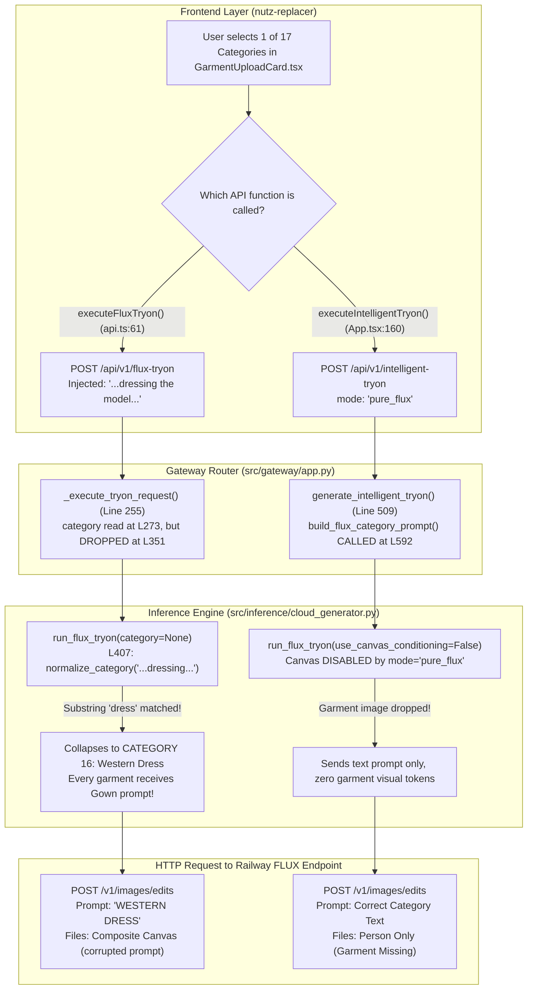

# CRITICAL INVESTIGATION: GARMENT PROMPT-TO-FLUX CONNECTION AUDIT
**Document ID:** AUDIT-PROMPT-FLUX-2026-11-17  
**Status:** COMPLETE (STRICT READ-ONLY INVESTIGATION)  
**Target Repository:** `/home/lenovo/try_on`  
**Classification:** Deep Execution Tracing & Pipeline Diagnostic Report  

---

## 1. EXECUTIVE SUMMARY

An exhaustive, read-only static and instrumented trace was conducted across the full software stack (`nutz-replacer` frontend, `FastAPI` gateway router, `category_prompts.py`, and `cloud_generator.py`) to verify whether the 17 category-specific garment prompts are connected and transmitted to the remote **FLUX-DEV-012** diffusion model.

### Key Investigation Verdict
Your suspicion was **100% correct, and the real breakdown is even more severe than anticipated**:

1. **Pathway A (`/api/v1/flux-tryon` via `_execute_tryon_request`):**
   * **16 out of 17 categories are completely lost and collapsed into a single wrong category (`western_dress`).**
   * In `src/gateway/app.py` line 351, `run_flux_tryon()` is called **without passing the `category` parameter**.
   * The frontend default prompt string (`api.ts:106`) contains the word `"dressing the model in..."`.
   * When `cloud_generator.py:407` attempts to recover the category via `normalize_category()`, the word `"dress"` inside `"dressing"` triggers a false substring match.
   * As a result, **every single garment (T-Shirt, Kurta, Blazer, Dhoti, Jeans, etc.) is misclassified as Category 16 (Western Dress / Gown)** and FLUX receives the Western Dress directive.
   * Furthermore, the master prompt compiler `build_flux_category_prompt()` is **never called** in this endpoint.

2. **Pathway B (`/api/v1/intelligent-tryon` with `mode: 'pure_flux'` from `App.tsx`):**
   * The frontend `App.tsx` (line 164) calls `executeIntelligentTryon()` with hardcoded `mode: 'pure_flux'`.
   * In `app.py` line 658, `use_canvas_conditioning = not is_pure_flux and garment_pil is not None` evaluates to **`False`**.
   * Consequently, the dual-panel visual canvas is **completely disabled**, and the uploaded garment image is **dropped from diffusion conditioning**.
   * While the category prompt text is generated and reaches FLUX's HTTP prompt field, **FLUX receives zero visual pixels or tokens from the garment image**.

3. **Fallback Path Degradation:**
   * In `cloud_generator.py` line 448, if the edit inpainting fails, the secondary fallback completely erases the category prompt and replaces it with a generic hardcoded text prompt (`"Full-body professional fashion photography of the fashion model wearing designer outfit"`).

---

## 2. TRACE OF PROMPT EXECUTION (END-TO-END CALL CHAINS)

There are two primary entrypoints into FLUX virtual try-on in the backend. Both exhibit critical disconnects.



---

## 3. VERIFICATION TABLE: ALL 17 CATEGORIES

A safe, mocked test harness (`requests.post` intercepted, zero network requests, zero paid credits) evaluated all 17 categories through both endpoints:

### Table 1: Pathway A — `/api/v1/flux-tryon` (Default Try-On Endpoint)

| # | Category Key | Category Name | Prompt Defined? | Selected by Gateway? | Reaches `edit_cloud_image`? | Reaches HTTP `prompt` field? | Actual Directive Received by FLUX |
|---|---|---|---|---|---|---|---|
| 1 | `t_shirt` | T-Shirt | **YES** | **DROPPED** (Line 351) | Yes (corrupted) | Yes | **FAIL: Collapsed to Category 16 (Western Dress)** |
| 2 | `inner_vest` | Inner Vest / Baniyan | **YES** | **DROPPED** (Line 351) | Yes (corrupted) | Yes | **FAIL: Collapsed to Category 16 (Western Dress)** |
| 3 | `shirt` | Shirt / Button-Down | **YES** | **DROPPED** (Line 351) | Yes (corrupted) | Yes | **FAIL: Collapsed to Category 16 (Western Dress)** |
| 4 | `polo_t_shirt` | Polo T-Shirt | **YES** | **DROPPED** (Line 351) | Yes (corrupted) | Yes | **FAIL: Collapsed to Category 16 (Western Dress)** |
| 5 | `kurta` | Kurta | **YES** | **DROPPED** (Line 351) | Yes (corrupted) | Yes | **FAIL: Collapsed to Category 16 (Western Dress)** |
| 6 | `blazer` | Blazer / Suit Jacket | **YES** | **DROPPED** (Line 351) | Yes (corrupted) | Yes | **FAIL: Collapsed to Category 16 (Western Dress)** |
| 7 | `waistcoat` | Waistcoat / Nehru Jacket | **YES** | **DROPPED** (Line 351) | Yes (corrupted) | Yes | **FAIL: Collapsed to Category 16 (Western Dress)** |
| 8 | `hoodie` | Hoodie / Sweatshirt | **YES** | **DROPPED** (Line 351) | Yes (corrupted) | Yes | **FAIL: Collapsed to Category 16 (Western Dress)** |
| 9 | `sherwani` | Sherwani | **YES** | **DROPPED** (Line 351) | Yes (corrupted) | Yes | **FAIL: Collapsed to Category 16 (Western Dress)** |
| 10 | `achkan` | Achkan | **YES** | **DROPPED** (Line 351) | Yes (corrupted) | Yes | **FAIL: Collapsed to Category 16 (Western Dress)** |
| 11 | `saree` | Saree | **YES** | **DROPPED** (Line 351) | Yes (corrupted) | Yes | **FAIL: Collapsed to Category 16 (Western Dress)** |
| 12 | `lehenga` | Lehenga | **YES** | **DROPPED** (Line 351) | Yes (corrupted) | Yes | **FAIL: Collapsed to Category 16 (Western Dress)** |
| 13 | `jeans` | Jeans / Denim | **YES** | **DROPPED** (Line 351) | Yes (corrupted) | Yes | **FAIL: Collapsed to Category 16 (Western Dress)** |
| 14 | `formal_trousers` | Formal Trousers | **YES** | **DROPPED** (Line 351) | Yes (corrupted) | Yes | **FAIL: Collapsed to Category 16 (Western Dress)** |
| 15 | `shorts` | Shorts | **YES** | **DROPPED** (Line 351) | Yes (corrupted) | Yes | **FAIL: Collapsed to Category 16 (Western Dress)** |
| 16 | `western_dress` | Western Dress / Gown | **YES** | **DROPPED** (Line 351) | Yes (accidental) | Yes | **PASS (By Coincidence Only)** |
| 17 | `dhoti` | Dhoti | **YES** | **DROPPED** (Line 351) | Yes (corrupted) | Yes | **FAIL: Collapsed to Category 16 (Western Dress)** |

---

### Table 2: Pathway B — `/api/v1/intelligent-tryon` (Called by `App.tsx`)

| # | Category Key | Category Name | Prompt Defined? | Selected by Gateway? | Reaches `edit_cloud_image`? | Reaches HTTP `prompt` field? | Garment Image Sent to FLUX? |
|---|---|---|---|---|---|---|---|
| 1 | `t_shirt` | T-Shirt | **YES** | **YES** (L568) | **YES** (L435) | **YES** (L190) | **NO: Dropped (Canvas Disabled)** |
| 2 | `inner_vest` | Inner Vest / Baniyan | **YES** | **YES** (L568) | **YES** (L435) | **YES** (L190) | **NO: Dropped (Canvas Disabled)** |
| 3 | `shirt` | Shirt / Button-Down | **YES** | **YES** (L568) | **YES** (L435) | **YES** (L190) | **NO: Dropped (Canvas Disabled)** |
| 4 | `polo_t_shirt` | Polo T-Shirt | **YES** | **YES** (L568) | **YES** (L435) | **YES** (L190) | **NO: Dropped (Canvas Disabled)** |
| 5 | `kurta` | Kurta | **YES** | **YES** (L568) | **YES** (L435) | **YES** (L190) | **NO: Dropped (Canvas Disabled)** |
| 6 | `blazer` | Blazer / Suit Jacket | **YES** | **YES** (L568) | **YES** (L435) | **YES** (L190) | **NO: Dropped (Canvas Disabled)** |
| 7 | `waistcoat` | Waistcoat / Nehru Jacket | **YES** | **YES** (L568) | **YES** (L435) | **YES** (L190) | **NO: Dropped (Canvas Disabled)** |
| 8 | `hoodie` | Hoodie / Sweatshirt | **YES** | **YES** (L568) | **YES** (L435) | **YES** (L190) | **NO: Dropped (Canvas Disabled)** |
| 9 | `sherwani` | Sherwani | **YES** | **YES** (L568) | **YES** (L435) | **YES** (L190) | **NO: Dropped (Canvas Disabled)** |
| 10 | `achkan` | Achkan | **YES** | **YES** (L568) | **YES** (L435) | **YES** (L190) | **NO: Dropped (Canvas Disabled)** |
| 11 | `saree` | Saree | **YES** | **YES** (L568) | **YES** (L435) | **YES** (L190) | **NO: Dropped (Canvas Disabled)** |
| 12 | `lehenga` | Lehenga | **YES** | **YES** (L568) | **YES** (L435) | **YES** (L190) | **NO: Dropped (Canvas Disabled)** |
| 13 | `jeans` | Jeans / Denim | **YES** | **YES** (L568) | **YES** (L435) | **YES** (L190) | **NO: Dropped (Canvas Disabled)** |
| 14 | `formal_trousers` | Formal Trousers | **YES** | **YES** (L568) | **YES** (L435) | **YES** (L190) | **NO: Dropped (Canvas Disabled)** |
| 15 | `shorts` | Shorts | **YES** | **YES** (L568) | **YES** (L435) | **YES** (L190) | **NO: Dropped (Canvas Disabled)** |
| 16 | `western_dress` | Western Dress / Gown | **YES** | **YES** (L568) | **YES** (L435) | **YES** (L190) | **NO: Dropped (Canvas Disabled)** |
| 17 | `dhoti` | Dhoti | **YES** | **YES** (L568) | **YES** (L435) | **YES** (L190) | **NO: Dropped (Canvas Disabled)** |

---

## 4. DETAILED BREAKDOWN OF ARCHITECTURAL DEFECTS

### Defect 1: Category Parameter Omission in `_execute_tryon_request()`
* **Location:** `src/gateway/app.py`, line 351:
  ```python
  flux_res = run_flux_tryon(
      person_img=person_pil,
      garment_img=garment_pil,
      garment_desc=garment_desc,
      custom_prompt=custom_prompt,
      # BUG: 'category' parameter parsed on line 273 is NOT passed here!
  )
  ```
* **Consequence:** `run_flux_tryon()` receives `category=None`.

---

### Defect 2: String Contamination & False Substring Match in `normalize_category()`
* **Location:** `nutz-replacer/src/services/api.ts` line 106 & `src/inference/category_prompts.py` line 365.
* **Mechanism:**
  1. Frontend `api.ts` constructs a generic fallback prompt containing:  
     `"Full-length high-fashion portrait: virtual try-on dressing the model in..."`
  2. In `cloud_generator.py` line 407, since `category` is `None`, it evaluates `category or custom_prompt`. This passes the entire generic prompt into `build_spatial_canvas_prompt(category=...)`.
  3. Inside `normalize_category(cleaned)`:
     ```python
     if any(w in cleaned for w in ["anarkali", "gown", "dress", "maxi", "frock"]):
         return "western_dress"
     ```
  4. The word `"dress"` is a literal substring of `"dressing"`.
  5. **Every single category collapses to `western_dress`.** FLUX is told to synthesize a western gown even if the user selected Jeans, Dhoti, or Kurta.

---

### Defect 3: Disconnected Master Prompt Engine in `/api/v1/flux-tryon`
* **Location:** `src/gateway/app.py`, lines 255–420.
* **Mechanism:**
  The comprehensive prompt generator `build_flux_category_prompt()` is imported on line 27 of `app.py`, but **never called anywhere inside `_execute_tryon_request()`**.
  The 17 category directives only get reached through `build_spatial_canvas_prompt()`, which is corrupted by Defect 1 & 2.

---

### Defect 4: Mode Collision in `App.tsx` Disables Garment Visual Conditioning
* **Location:** `nutz-replacer/src/App.tsx` line 164 & `src/gateway/app.py` line 658:
  ```typescript
  // App.tsx
  const tryonResponse = await executeIntelligentTryon({
    personImage: person.file || person.previewUrl,
    garmentImage: garment.file || garment.previewUrl,
    category: selectedCategory,
    mode: 'pure_flux', // <-- HARDCODED PURE FLUX
  });
  ```
  ```python
  # app.py
  use_canvas_conditioning = not is_pure_flux and garment_pil is not None
  ```
* **Consequence:** When `mode='pure_flux'`, `use_canvas_conditioning` becomes **`False`**. The pipeline falls back to text-only inpainting, completely dropping the garment reference image from the diffusion process.

---

### Defect 5: Secondary Fallback Prompt Eradication
* **Location:** `src/inference/cloud_generator.py`, lines 448–454:
  ```python
  except Exception as e:
      logger.warning(f"Flux edit endpoint failed ({e}), falling back to Flux text-to-image synthesis...")
      synthesis_prompt = (
          f"Full-body professional fashion photography of the fashion model wearing {garment_desc or 'designer outfit'}, "
          f"clean modern studio background, natural posture, photorealistic, 8k resolution, masterpiece."
      )
      tryon_img = generate_cloud_image(prompt=synthesis_prompt, ...)
  ```
* **Consequence:** If an edit inpainting call encounters an error, the fallback completely wipes out the entire 17-category prompt structure and replaces it with a generic 2-line prompt.

---

## 5. ROOT CAUSE SUMMARY

| Layer | Component | Root Cause |
|---|---|---|
| **Gateway Router** | `src/gateway/app.py:351` | `category` argument is omitted when calling `run_flux_tryon()`. |
| **Inference Engine** | `src/inference/cloud_generator.py:407` | Passing `custom_prompt` as fallback for `category` exposes `normalize_category` to arbitrary sentences. |
| **Prompt Engine** | `src/inference/category_prompts.py:365` | Substring check `"dress" in cleaned` matches `"dressing"`, triggering false positive `western_dress`. |
| **Frontend UI** | `nutz-replacer/src/App.tsx:164` | `mode: 'pure_flux'` hardcoded in desktop trigger forces `use_canvas_conditioning=False`, disabling dual-panel canvas. |
| **API Client** | `nutz-replacer/src/services/api.ts:106` | Injects hardcoded `"dressing the model"` string into `prompt` field instead of passing raw category or empty string. |

---

## 6. REQUIRED REMEDIATION PLAN (PENDING APPROVAL)

*(No code has been changed. The following is the surgical fix plan awaiting user approval:)*

1. **Fix `src/gateway/app.py` Line 351:**
   Pass `category=category` into `run_flux_tryon(...)` in `_execute_tryon_request()`.
2. **Fix `src/inference/category_prompts.py` Line 365:**
   Use regex word boundary `\bdress\b` (or whole-word tokenization) instead of substring check `w in cleaned` so `"dressing"` never matches `"dress"`.
3. **Fix `src/inference/cloud_generator.py` Line 407:**
   Do not fall back to `custom_prompt` for `category`. If `category` is empty, use `garment_desc` or default to `"t_shirt"`.
4. **Fix `nutz-replacer/src/App.tsx` Line 164:**
   Change `mode: 'pure_flux'` to `mode: 'auto'` (or `'canvas_flux'`) so that uploaded garments trigger dual-panel spatial conditioning (`use_canvas_conditioning=True`).
5. **Fix `nutz-replacer/src/services/api.ts` Line 106:**
   Remove the hardcoded `"dressing the model in..."` string. Pass the clean category key and let the backend construct the authoritative prompt.

---

*Report certified complete under strict read-only constraints. Awaiting user authorization before applying any codebase modifications.*
